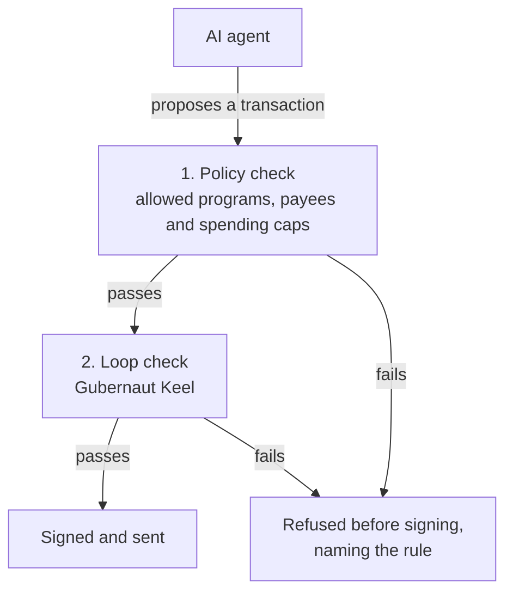

# Solanaut

**A transaction firewall for Solana AI agents.**

Before an AI agent's wallet signs anything, Solanaut checks it against rules the agent cannot change.
An agent that has been tricked still cannot pay an address you never allowed.


Built for Colosseum's Crypto World's Fair hackathon.

---

## The problem

AI agents now hold wallets, and a wallet signs whatever the agent hands it. When the agent is fooled, confused or
loses its memory, real money moves:

- **A rule kept in a prompt is not a rule.** Freysa's only rule, "never send the money", lived in its prompt. On attempt
  482, it paid out $47,316 (a paid game built to be attacked, on Base).
- **Lost state is lost money.** On Solana, an agent meant to spend about 4 SOL sent about 5% of a token's supply after a
  crash erased its wallet state. Its owner says it was not an attack.
- **Bots retry, and retries cost.** From 2023 to 2024, automated accounts' Solana transactions failed 58% of the time,
  against 6% for people. An agent that retries carelessly can pay twice.

Asking the model to behave does not fix this. Research on ElizaOS found that prompt-injection defences "only provide
limited protection when stored context is corrupted". Sources for each fact: [docs/CLAIMS.md §5](docs/CLAIMS.md).

## What Solanaut does

It sits between the agent and its key. The agent **proposes** a transaction, Solanaut **checks** it, and only then can
it be **signed**.



1. **A policy.** You write it: which programs the agent may call, which addresses it may pay, and how much it may spend
   per transaction and per time window. The model cannot change it.
2. **A loop brake.** [Gubernaut Keel](https://www.npmjs.com/package/@gubernaut/core), an open-source control loop, reads
   three numbers about the stream of proposals and stops an agent that keeps retrying the same failing transaction.

Every refusal names the rule to the operator; the agent receives a class and record reference. Nothing refused by the
guard is signed through its adapters. If anything goes wrong inside the guard,
the answer is no. On-chain, a **Squads v4 spending limit** caps what the agent's key can move, even if the key itself is
stolen.

## What has been shown so far

| What was tested | Result | Evidence |
|---|---|---|
| Forty transactions shaped like real drains: new recipients, token approvals, authority changes and more | each refused before signing, by a named rule | [beta gate](evals/verify/beta-gate.md) |
| A failing payment retried again and again | stopped at the third attempt, in the sandbox | [loop tests](evals/sdk/keel.md) |
| Ordinary payments, in synthetic test streams | none of 600 wrongly stopped | [loop tests](evals/sdk/keel.md) |
| The guard killed mid-run, at 20 random points | restarted each time with an identical record | [restart tests](evals/sdk/durable.md) |
| A stolen key, on devnet | Squads' program refused it past its limit, to an unlisted address, and after the limit was revoked | [devnet drill](evals/onchain/squads-devnet.md) |
| The demo, end to end on devnet | payments landed; an unlisted payee, a token approval and a durable-nonce payment were refused before signing | [devnet scenes](evals/e2e/scenes-devnet.md) |
| A Solana Agent Kit agent | adopted Solanaut by changing one line; drains refused before the wallet was asked to sign | [Agent Kit run](evals/agentkit/sak-devnet.md) |

Every number above, with its scope and the command that reproduces it, is in [docs/CLAIMS.md](docs/CLAIMS.md).

## What it does not claim

- **It is not an injection detector, and not "un-hackable".** Its defence against prompt injection is the policy, which
  does not need to notice anything. If you allow an address, a fooled agent can still pay it.
- **The policy is only as safe as where it is kept.** It must stay out of the agent's reach.
- **Denial classes do not hide the policy from neighbouring code.** SDK adapters give the model a class and reference;
  operator callbacks receive the reason. Code in the same process can still inspect the guard, and an agent can learn
  by probing. Operator-signed full disclosure is available for development
  ([ADR-025](design/ADR-025-denial-disclosure.md)).
- **Devnet only.** No real funds, and no detection rate is claimed.

## Try it in two minutes

No wallet or SOL needed. You need Node.js 26 ([TOOLCHAIN.md](TOOLCHAIN.md)).

```bash
npm install
npm run sandbox     # three scenarios, offline: normal payments, a drain attempt, a retry loop
npm test            # the full test suite
```

The sandbox prints each proposal, the three numbers the loop saw, and the verdict. With a local Solana validator
(`npm run validator` in another terminal, then `npm run sandbox -- --cluster local`), the allowed payments land, and the
drain and the loop's last attempt are never sent.

## For developers

With Solana Agent Kit, adopting Solanaut is one changed line:

```ts
import { createGuard, guardedWallet } from "@solanaut/sdk";

const guard = await createGuard({ policy });   // your allowed programs, payees and caps
const agent = new SolanaAgentKit(guardedWallet(wallet, guard, { rpc }), rpc, {});
```

For `@solana/kit`, `guardedSigner` wraps a signer the same way. A full offline walkthrough of the API is in
[examples/offline-preview.mjs](examples/offline-preview.mjs). The SDK is not yet published to npm; it runs from this
repository. One known limit: the kit's plugin actions sign each payment twice, and the guard refuses the second
signature ([docs/CLAIMS.md](docs/CLAIMS.md), S10).

## Read more

| If you have | Read |
|---|---|
| 5 minutes | [docs/PRODUCT.md](docs/PRODUCT.md): what Solanaut is, why it exists and how it works, on one page |
| 15 minutes | [docs/papers/LITEPAPER.md](docs/papers/LITEPAPER.md): the research and the design |
| a business eye | [docs/papers/MARKET.md](docs/papers/MARKET.md) and [docs/papers/BUSINESS-PLAN.md](docs/papers/BUSINESS-PLAN.md) |
| a technical eye | [docs/OVERVIEW.md](docs/OVERVIEW.md) (the code), [docs/papers/THREAT-MODEL.md](docs/papers/THREAT-MODEL.md) (the attacks) |
| doubts | [docs/CLAIMS.md](docs/CLAIMS.md): every claim, its evidence, and the words Solanaut refuses to use |

The full reading guide is [docs/README.md](docs/README.md).

## Where it stands

- **Beta: built and validated on devnet.** Everything in the table above.
- **Alpha: in progress.** A separate signer process, operator-signed policies, stronger crash recovery and much heavier
  testing are built and tested piece by piece. They are not yet a released milestone.
  See [PROGRESS.md](PROGRESS.md) and [docs/ROADMAP.md](docs/ROADMAP.md).
- **CI runs on every push, and is honest about what is still open.** A red mark next to a commit means one of the
  stricter release gates still fails. Today that is the full fault campaigns, which do not yet finish inside the job's
  time limit. It is tracked in [PROGRESS.md](PROGRESS.md), not hidden.

## How it was built

One developer directed AI coding agents (Claude Code, then Codex) under strict rules. Every milestone has a test gate,
first shown failing and then passing. Every number names the command that reproduces it. Every decision is written down.
Those working files are public on purpose:

| Folder | What is in it |
|---|---|
| [packages/sdk/](packages/sdk/) | **the product**: the guard and its adapters |
| [apps/](apps/) | the sandbox, the dashboard, the signer, the devnet scripts, the Agent Kit demo |
| [docs/](docs/) | product, research, roadmap and claims |
| [design/](design/) | the decision records (ADRs) |
| [evals/](evals/) | the evidence: every gate, seen failing, then passing |
| [kb/](kb/) | the research vault: sources and notes, readable in Obsidian |
| [runs/](runs/), [PROGRESS.md](PROGRESS.md) | the build log, one record per session |
| `plugins/`, `workflows/`, `tools/`, `.claude/`, `.codex/`, [CLAUDE.md](CLAUDE.md), [AGENTS.md](AGENTS.md) | the agents' rules and safety checks |

## Built on, and disclosed

- **[Gubernaut Keel](https://github.com/thegubernaut/keel)** (`@gubernaut/core` 1.0.1, Apache-2.0): the loop brake. It is
  pre-existing open-source work, used unmodified from npm and disclosed under the hackathon's rules.
- **[Squads v4](https://squads.so)** for the on-chain spending limit, **[@solana/kit](https://github.com/anza-xyz/kit)**,
  and **[Solana Agent Kit](https://github.com/sendaifun/solana-agent-kit)**.

## Licence

[Apache-2.0](LICENSE). See also [NOTICE](NOTICE).
